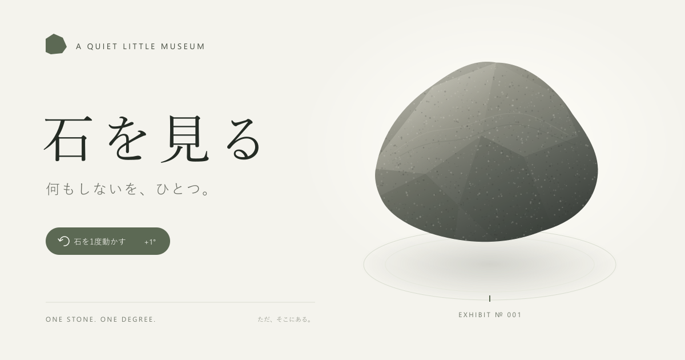
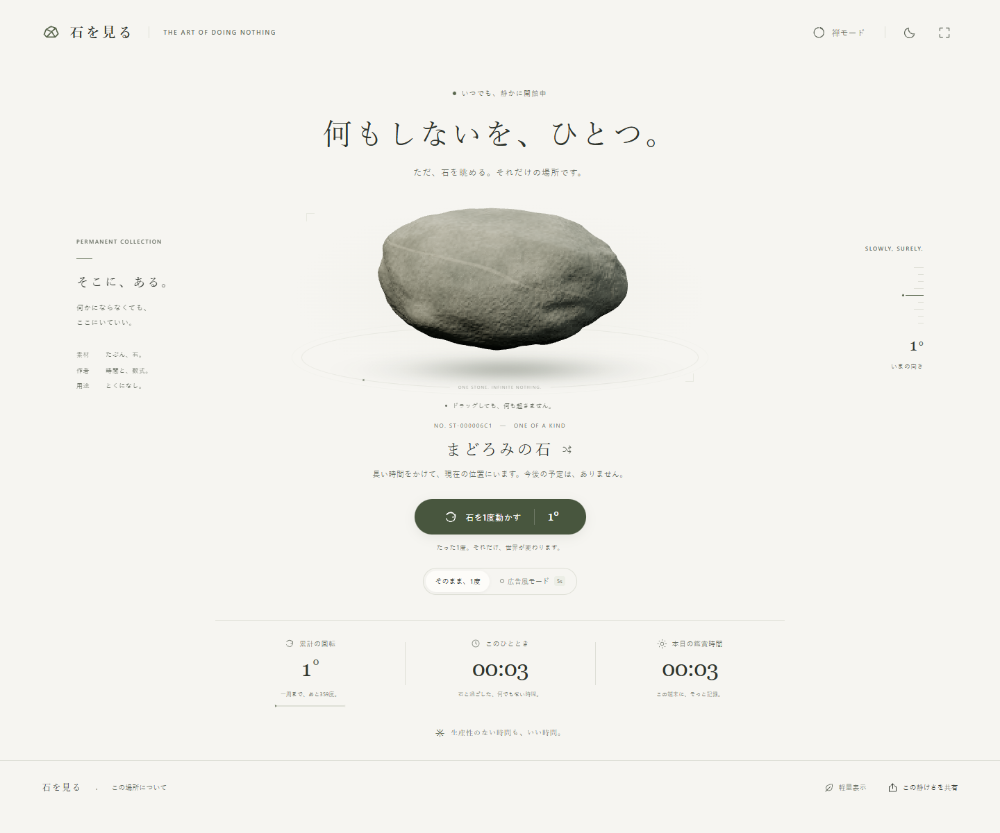
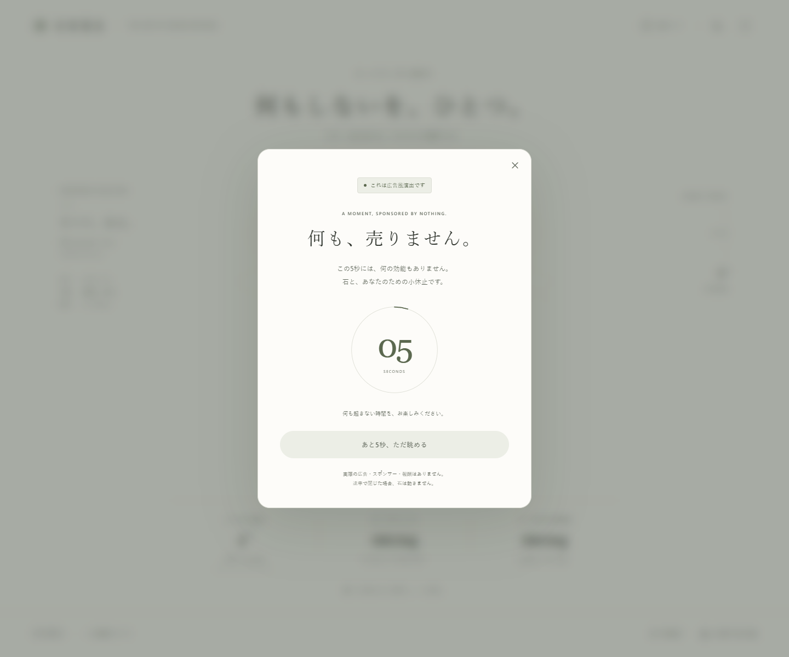
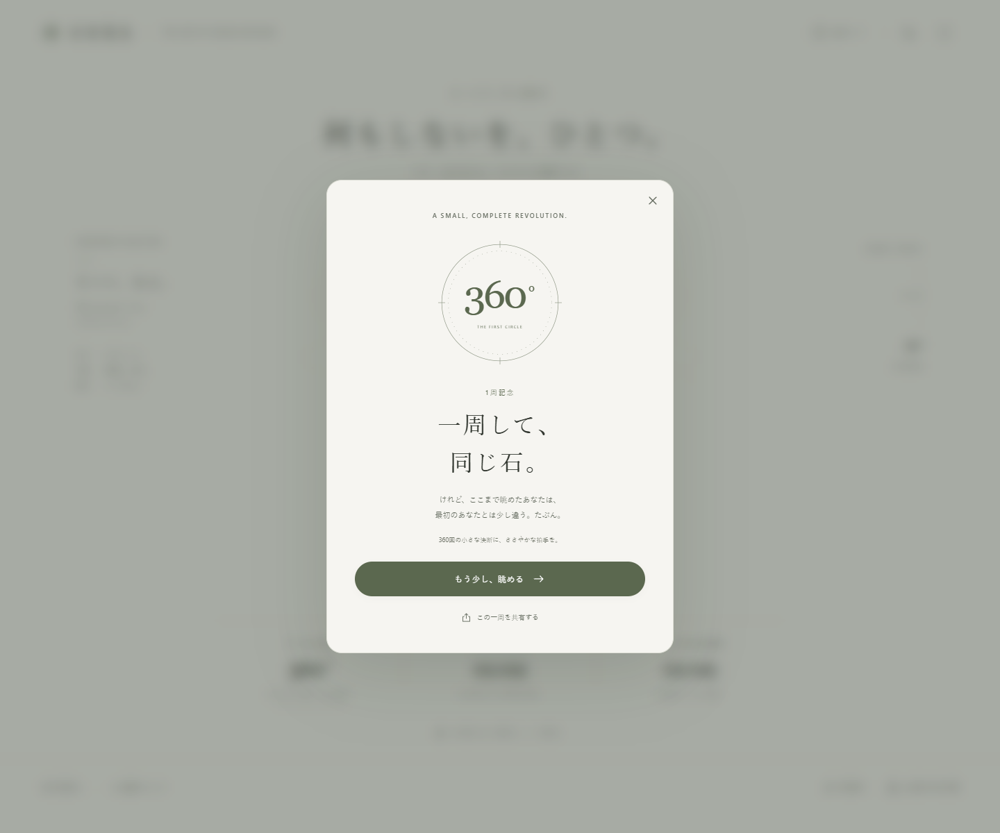
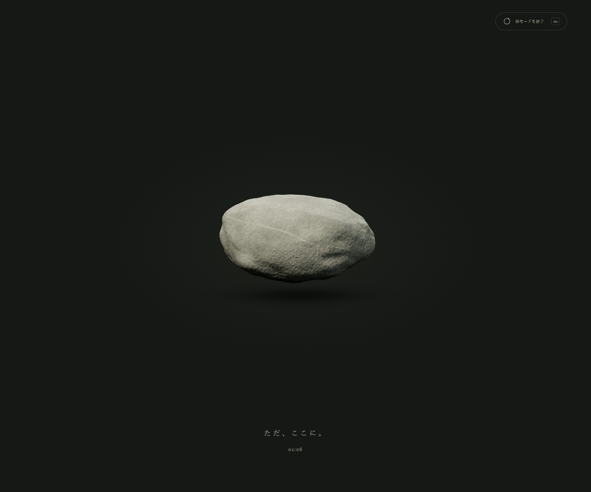

# 石を見る

**何もしないを、ひとつ。**

画面中央の石を、ただ眺めるための小さなデジタル美術館です。
「石を1度動かす」を押すと、石が正確に1度だけ回転します。
360回押したときには、ささやかな1周記念演出があります。特に景品はありません。



- 公開URL：[石を見る](https://stone-viewer-iota.vercel.app)
- GitHub：[shunsoco-stack/stone-viewer](https://github.com/shunsoco-stack/stone-viewer)（公開リポジトリ）
- リポジトリ名：`stone-viewer`
- 紹介文・投稿用コピー：[docs/publish-copy.md](docs/publish-copy.md)
- セキュリティ・データの扱い：[docs/security.md](docs/security.md)
- 公開時の実測・検証結果：[docs/verification.md](docs/verification.md)

## できること

- オリジナルのプロシージャル形状を、Three.js / WebGLで立体表示
- 環境光、柔らかい影、緩やかな浮遊表現
- 1操作につき1度の回転、累計回転角度の表示、360度ごとの記念演出
- 現在の鑑賞時間と、本日の鑑賞時間の表示・端末内保存
- 5秒間の「広告風演出」を見終えると、1度回せるモード
- UIを静かにしまう禅モード、全画面表示、ダークモード
- ランダムな石の名前と、役に立たない説明文
- Web Share APIを利用した共有と、利用できない環境でのリンク共有
- 低スペック端末向けの軽量表示、WebGLが使えない場合のSVGフォールバック
- モバイル対応、PWA用manifest・アイコン・Service Worker

石のドラッグ回転・ピンチ操作・自動回転はありません。浮遊は位置の変化だけで、回転角度を増やしません。

### 1度の仕組み

回転の論理状態を整数の回転回数として扱い、角度へ変換します。
表示の補間アニメーションと累計値を分離し、連続クリックでも小数誤差を積み上げない構成です。
一周しても累計角度は0に戻りません。360度、720度……と、眺めたぶんだけ積み重なります。

### 広告風演出について

画面に「これは広告風演出です」と明示した、アプリ内の短いジョーク演出です。
実際の広告・広告SDK・スポンサー・報酬広告サービスは導入していません。
画面を離れるとカウントは一時停止し、戻ると再開します。
5秒が完了すると「石を1度動かす」が有効になり、押したときに1度だけ動きます。
途中で閉じた場合は回転しません。通常モードへはいつでも戻せます。
課金や有料APIはありません。

### 鑑賞時間について

ブラウザでページが表示されている時間を鑑賞時間として扱います。タブが非表示の間は加算しません。
計測間隔が5秒を超えた場合や、システム時刻が大きく変化した場合は、その区間を加算しません。端末のスリープ時間を鑑賞時間としてまとめて足さないための仕組みです。
実際に画面を見ているかどうかをカメラなどで判定するものではありません。

「このひととき」は今回ページを開いてからの鑑賞時間、「本日の鑑賞時間」は端末内の当日分の合計です。
日別記録は整数のミリ秒で保持し、ブラウザのローカル日付を基準に`localStorage`へ保存します。
日付をまたぐ区間は現地時間の午前0時で分割し、今日を含む直近30日分だけを保持します。
保存は約5秒ごとのほか、操作時やページを離れるときに行います。ブラウザの強制終了などでは、保存直前の数秒が失われる場合があります。

保存キーは`stone-viewer:v1`です。日別時間に加えて、累計回転回数、石のシード・名前、テーマ、回転モード、軽量表示の設定を保存します。
記録はその端末・そのブラウザのものです。別端末への同期やアカウント登録はありません。
ブラウザのサイトデータを削除すると記録も消えます。
保存が禁止されている場合や容量不足の場合は、メモリ内で操作・計測を続け、「今回だけの記録」と表示します。その場合、再読み込み後の記録保持はできません。

### 共有について

端末の共有機能を使い、石の名前・累計角度・アプリのURLを共有します。共有先の選択は利用者が行います。
端末の共有機能が利用できない場合はクリップボードへコピーし、それも使えない場合は文章を選択して手動コピーできる画面を表示します。
共有をキャンセルした場合は、共有成功イベントとして数えません。
共有URLはアプリのトップページです。相手の端末に鑑賞記録を移したり、同じ石の状態を復元したりするリンクではありません。

## 技術構成

| 用途 | 技術 |
| --- | --- |
| フレームワーク | Next.js 16.3.3 安定版 / App Router |
| UI | React 19.2.8 / TypeScript 5.9 / Tailwind CSS 4 |
| 立体表示 | Three.js 0.185.1 |
| 計測 | Vercel Web Analytics |
| テスト | Vitest / Playwright / axe-core |
| 静的アセット生成 | オリジナルSVG / sharp |
| 公開先 | Vercel / GitHub |
| 実行環境 | Node.js 24 |

石の形状・表面表現・アイコン・OG画像は自作です。
外部の3Dモデル、ストックフォト、素材販売サイトのアセットは使用しません。石の生成・鑑賞に外部APIへの接続は不要です。
画面の文字にはOS標準フォントを利用し、フォントファイルを再配布しません。
利用ライブラリのライセンスはそれぞれのパッケージに従います。

## ローカルで起動

Node.js 24を用意して、このリポジトリのディレクトリで実行します。

```sh
npm ci
npm run dev
```

ブラウザで`http://localhost:3000`を開いてください。鑑賞機能にAPIキーは不要です。

### 品質チェック

```sh
npm run lint
npm run typecheck
npm run test
npm run secret:scan
npm run build
```

まとめて実行する場合は`npm run verify`を使えます。
`typecheck`は`next typegen`と`tsc --noEmit`を実行し、App Routerの型も確認します。
GitHub Actionsにも、Node.js 24で同じ品質チェックを行うワークフローを用意しています。

ブラウザテストは、PlaywrightのChromiumをインストールしたうえで実行します。

```sh
npx playwright install chromium
npm run test:e2e
```

初回コミット`a478e2f`の[GitHub Actions実行は成功しています](https://github.com/shunsoco-stack/stone-viewer/actions/runs/33040835487)。
変更後の状態は[最新のCI実行](https://github.com/shunsoco-stack/stone-viewer/actions/workflows/quality.yml)で確認してください。
このCIはlint・型検査・ユニットテスト・Secret Scan・ビルドを対象とし、E2Eや公開後のPWA検証は別途実行します。

### アセットの再生成

```sh
npm run assets
```

`scripts/generate-assets.mjs`に、石の輪郭・グラデーション・シード付き粒子表現を定義しています。
外部から画像を取得せず、次のアセットを生成します。

| パス | 用途 |
| --- | --- |
| `public/icon.svg` | ベクターアイコン |
| `public/icons/icon-192.png` | PWAアイコン（192×192） |
| `public/icons/icon-512.png` | PWAアイコン（512×512） |
| `public/icons/maskable-512.png` | マスク対応アイコン（512×512） |
| `public/apple-touch-icon.png` | ホーム画面アイコン（180×180） |
| `public/favicon.ico` | favicon（16 / 32 / 48 / 256） |
| `public/og.png` | 共有用OG画像（1200×630） |

OG画像の再生成には、利用環境に日本語対応のシステムフォントが必要です。
生成済みアセットをコミットしているため、通常のビルドでの再生成は不要です。

## PWA・互換性

対応ブラウザでは、ホーム画面やアプリ一覧へ追加できます。インストールUIと全画面APIの対応状況はブラウザによって異なります。
PWA / Service WorkerにはHTTPS、または開発用の`localhost`が必要です。
Service Workerは本番ビルドでのみ登録します。`npm run dev`はオフライン対応の検証対象ではありません。
初回アクセスにはネットワーク接続が必要で、オフラインで扱える範囲はService Workerによるキャッシュ済みコンテンツに限られます。

### オフラインで使える範囲

トップページ、manifest、アイコンと、読み込んだ同一オリジンの`/_next/static/`内のJS・CSSをキャッシュします。
ページ本体と必要なJS・CSSのキャッシュが完了していれば、オフラインでも石の画面を開き直し、回転・鑑賞時間・表示設定などの操作を続けられる設計です。
Three.jsの遅延読み込み用チャンクが未取得の場合は、SVGの石を表示します。
初回の読み込み途中、キャッシュが消去された場合、ブラウザが保存領域を利用できない場合のオフライン起動は保証しません。
実際の共有先への送信や、Analyticsの受信確認にはオンライン環境が必要です。

### PWAの検証手順

1. `npm run build`のあと`npm run start`で起動するか、HTTPSのProduction URLを開きます。
2. 一度オンラインで画面を読み込み、Service Workerが有効になり、必要なJS・CSSがCache Storageへ保存されたことを確認します。
3. ブラウザをオフラインに切り替えて再読み込みし、画面・回転操作・記録表示を確認します。
4. オンラインへ戻して再読み込みし、新しい表示と通信へ復帰することを確認します。
5. 対応ブラウザのホーム画面追加と、追加後のstandalone表示を確認します。

Playwrightによる自動検証は、次のコマンドで実行できます。

```sh
node scripts/verify-pwa.mjs https://stone-viewer-iota.vercel.app
```

結果は既定で`.local/pwa-verification.json`へ保存します。第2引数でレポートの保存先を指定できます。
manifest・アイコン寸法・セキュリティヘッダー・Chromiumのインストール要件を確認し、通常のHTTPキャッシュを無効にした状態で、オフライン再読み込み・1度の回転・記録保持・未取得のThree.jsチャンクのSVGフォールバック・再接続を検査します。
最新の実行結果はレポートの`result`と各`checks`を確認してください。
**実際のOSへのインストールとstandaloneウィンドウの起動は未検証です。** また、異なるリリース間での更新再現はこのスクリプトの検証範囲に含みません。
画像やキャッシュ方針を変更するリリースでは、`public/sw.js`の`CACHE`バージョンも更新してください。旧キャッシュは新しいService Workerの有効化時に整理します。

### 描画の互換性

WebGLの初期化失敗やコンテキスト喪失などで立体表示を続けられない場合は、オリジナルSVGの石へ切り替えます。
フォールバックでも、回転回数や鑑賞時間などの機能を利用できます。SVGでは、立体の向きの代わりに平面上の1度の回転で表現し、画面にも「軽量表示」と明示します。
データ節約設定や、取得できた端末情報でメモリ2GB以下・論理コア2以下と判定した環境では、自動でSVGを選びます。フッターから手動で切り替えることもできます。
軽量表示ではThree.jsの遅延読み込みを行いません。
端末の動きを減らす設定では、鑑賞を妨げるアニメーションを抑えます。

## Vercel Analyticsと無料運用

ページビュー用のVercel Web Analyticsと、次の独自イベント送信処理を用意しています。
カスタムイベントのプロパティは各2項目以内です。

| イベント | 内容 | プロパティ |
| --- | --- | --- |
| `stone_rotate` | 石を1度回転 | `degrees`, `mode` |
| `stone_viewing_time` | 鑑賞時間の区間集計 | `seconds`, `total_seconds` |
| `stone_share` | 共有操作 | `method`, `degrees` |

鑑賞時間は毎秒ではなく、約60秒ごとの差分と、ページを非表示にする際などの残り時間を送る構成です。
共有イベントは、端末の共有処理の完了、クリップボード書き込みの成功、または手動コピー時に送ります。

**重要：Vercelの独自イベント集計はPro / Enterpriseプラン向けです。Hobbyでは利用できません。**
2026年8月27日確認の[公式カスタムイベント文書](https://vercel.com/docs/analytics/custom-events)と[公式の料金・制限](https://vercel.com/docs/analytics/limits-and-pricing)に基づきます。

無料運用を優先し、`NEXT_PUBLIC_ENABLE_CUSTOM_EVENTS`は既定で無効です。
対応プランを既に利用し、料金・利用枠を確認した場合に限り、`true`を設定して再ビルドすると独自イベントを有効化できます。
このプロジェクトでは有料プランへの変更、有料アドオンの追加、トライアル開始は行いません。
Hobbyではページビュー計測と、アプリ内のローカル鑑賞記録を利用します。

公開先のVercelプロジェクト`stone-viewer`はHobbyプランで、無料枠のWeb Analyticsを有効化済みです。
別のプロジェクトへ移す場合は、そのプロジェクトの設定でもWeb Analyticsを有効にしてください。
送信コードの実装と、Vercelダッシュボード上での受信確認は別の確認事項です。
ブラウザの追跡防止設定やオフライン状態によって、計測は送信されない場合があります。
`Do Not Track`が有効な場合は送信せず、ページビューのURLからクエリとハッシュを取り除きます。
イベントに氏名・メールアドレス・石の名前・日別記録そのものを含めません。

## 公開

GitHubの公開リポジトリと、Vercelの本番サイトを公開しています。

- Vercelプロジェクト：`stone-viewer`（Next.js / Node.js 24）
- 本番サイト：[https://stone-viewer-iota.vercel.app](https://stone-viewer-iota.vercel.app)
- ソースコード：[https://github.com/shunsoco-stack/stone-viewer](https://github.com/shunsoco-stack/stone-viewer)

**現在の公開経路はVercel CLIによる手動デプロイです。** GitHubリポジトリとの自動デプロイ連携は接続が完了していません。
GitHubへpushすると品質チェックは実行されますが、それだけではVercelの本番サイトは更新されません。

### 更新・再デプロイ

このリポジトリのルートで実行します。親フォルダの別プロジェクトを含めないでください。

```sh
npm ci
npm run verify
npm run test:e2e
```

Vercel CLIを初めて使う環境では、認証後に`npx vercel link`で**既存の`stone-viewer`プロジェクト**を選択します。

```sh
npx vercel login
npx vercel link
```

正しいアカウント・プロジェクトへの接続を確認してから、本番へデプロイします。

```sh
npx vercel --prod
```

環境変数は`.env.example`を参照してください。`NEXT_PUBLIC_SITE_URL`は公開URL、`NEXT_PUBLIC_ENABLE_CUSTOM_EVENTS`はHobbyで`false`に設定します。
`.env*`や`.vercel/`の認証・設定ファイルはコミットしません。
デプロイ後は本番の操作を再検証し、次のスクリーンショットとPWAレポートを更新してください。

## スクリーンショット

公開済みのProduction URL上で、Playwright Chromiumを使って撮影した5枚です。
撮影元URL、撮影時刻、画面サイズ、レンダラー、累計角度、ブラウザエラーの記録は[docs/screenshots.json](docs/screenshots.json)に保存しています。

撮影は独立したテスト用ブラウザで行い、再現可能な石を0度から表示します。
回転はすべてUI操作で、**0度 → 1度 → 5秒の広告風演出を完了して2度 → さらに358回押して360度**と進めます。
一周記念を閉じたあと、夜の展示室へ切り替え、禅モードを撮影します。

再撮影コマンド：

```sh
npx playwright install chromium
npm run screenshots -- https://stone-viewer-iota.vercel.app
```

画像は`public/screenshots/`へ、撮影記録は`docs/screenshots.json`へ上書き保存します。
UIを更新した場合は再撮影し、画像と記録を一緒にコミットしてください。

### 1. 石の初期画面


### 2. 1度回転した画面



### 3. 広告風演出



### 4. 360度達成画面



### 5. 禅モード



## このアプリがしないこと

石を売りません。石を採掘しません。投資を勧めません。生産性の向上も保証しません。
石の名前や説明文は創作で、鉱物学的な鑑定ではありません。
ちょっと立ち止まる時間があれば、それで十分です。
